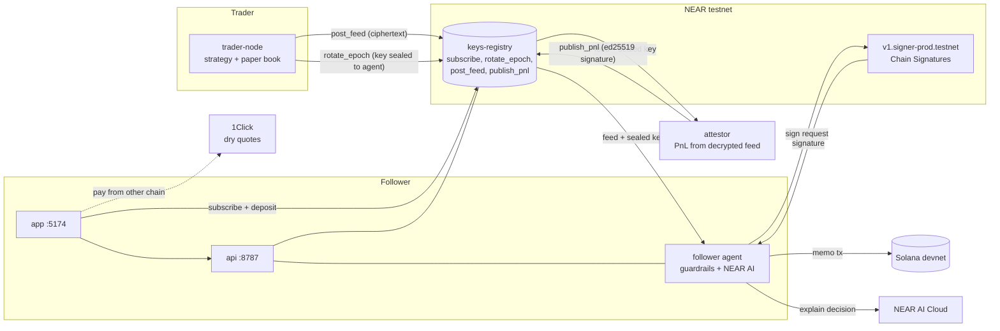
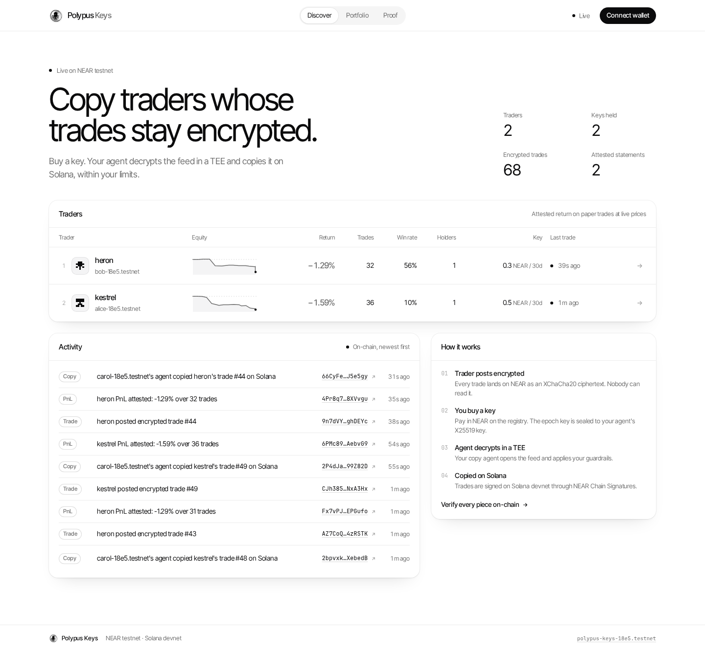
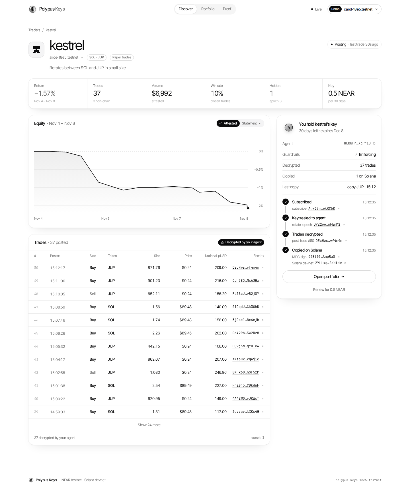
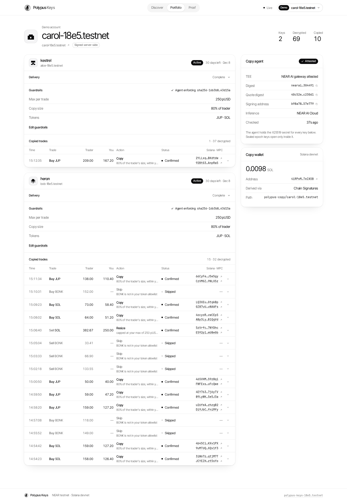
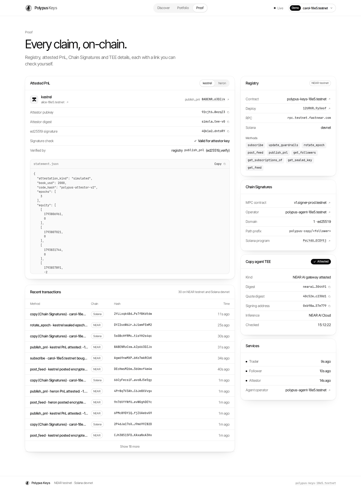

# Polypus Keys

Private copy-trading on Solana, built on NEAR. Submission to NEAR HACKATHON (tracks: Privacy & Private AI, Unstoppable DeFi, Agent Economy, AI Security & Defense). Site: https://polypus.fi

> Unaudited hackathon code. NEAR testnet and Solana devnet only. No mainnet funds are used or moved.

## Problem

Copy-trading platforms publish every trade. The trader is front-run and copied for free, and a follower hands an opaque bot or a custodian control of their funds. Traders have no way to sell access to a strategy without leaking it.

## What it does

- A trader posts each trade **encrypted** to a NEAR contract (XChaCha20-Poly1305, one key per epoch).
- A follower buys a **key** by calling `subscribe` on the registry and paying the trader in NEAR. The key is the epoch key, sealed (X25519) to the follower's **agent**, never to the human. The buyer never sees the trades.
- The agent decrypts the feed, applies the follower's **guardrails** (max per trade, copy size, token allowlist; committed on-chain as a hash), and copies on Solana. The trader's returns on the leaderboard are computed by an **attestor** from the same encrypted feed and published as a signed statement that the contract verifies (ed25519).
- The copy is signed with **NEAR Chain Signatures**: each follower gets an MPC-derived Solana address controlled by NEAR, so no Solana private key exists anywhere.

## How NEAR is used

| NEAR piece | Use | Code |
|---|---|---|
| Contract on testnet (`polypus-keys-18e5.testnet`) | Trader registry, subscriptions and payments, sealed epoch keys, encrypted feed, on-chain verification of attested PnL (`env::ed25519_verify`), guardrail commitments | [contracts/keys-registry](contracts/keys-registry) |
| Chain Signatures (`v1.signer-prod.testnet`, Ed25519) | Signs the Solana devnet copy transaction from an address derived per follower | [agents/shared/chainsig.ts](agents/shared/chainsig.ts) |
| NEAR Intents 1Click (with partner JWT) | Confidential dry quotes for paying the key from another chain (USDC/ETH/SOL/BTC to wNEAR). Mainnet quote API, `dry: true`, nothing is paid | [agents/shared/oneclick.ts](agents/shared/oneclick.ts) |
| NEAR AI Cloud | Each copy decision is explained by a model (`zai-org/GLM-5.1-FP8`); the gateway's signature over `sha256(request):sha256(response)` is recovered and checked locally, and the gateway attestation report is fetched with a fresh nonce and bound into the agent's attestation digest | [agents/shared/nearai.ts](agents/shared/nearai.ts), [agents/shared/tee.ts](agents/shared/tee.ts) |
| NEAR Wallet Selector | Real wallet purchase (MyNearWallet, Meteor, Intear, HERE) | [apps/keys/src/wallet](apps/keys/src/wallet) |

## Architecture



Data path of one copy: trader node encrypts the trade, `post_feed` stores the ciphertext, the agent reads it with the epoch key sealed to it, runs guardrails, asks NEAR AI to explain the decision, asks the MPC contract to sign a Solana transaction, and submits it to devnet. Every step produces a transaction that the app links in its timeline.

## Try it

Requirements: Node 22+, a Linux/macOS shell. Rust is only needed for the contract and protocol tests.

### A. UI with a mock API (no credentials needed)

1. `npm install`
2. `npm run mock:api -w apps/keys` (fixture data on 127.0.0.1:8787; transaction hashes are random and do not resolve)
3. In a second terminal: `npm run app`, then open http://127.0.0.1:5174
4. You see **Discover** with two traders and their equity curves. Click a trader. You see locked, redacted trades.
5. Click **Try with a demo account**. You see the timeline fill in: subscribe, key sealed, trades decrypted, Chain Signatures sign, Solana copy (simulated by the mock).

This path exists to inspect the UI. It does not touch NEAR or Solana.

### B. Live stack (NEAR testnet + Solana devnet)

The live services sign as testnet accounts (`alice-18e5`, `bob-18e5`, `carol-18e5`, `polypus-agent-18e5`, the demo account) whose keys are read from `~/.near-credentials/testnet` and are not in this repository. With those credentials:

1. `npm install`
2. `cp .env.example .env` and set `NEARAI_API_KEY`, `ONECLICK_PARTNER_JWT`, `POLYPUS_DEMO_ACCOUNT` (all optional, see below)
3. `npm run setup:agent` once, then `npm run setup:live` once (registers the attestor, seals the epoch key to it, backfills trader history at real historical prices)
4. `npm run dev:all`
5. Open http://127.0.0.1:5174, pick **kestrel**, click **Try with a demo account** (or **Buy key** to sign `subscribe` from your own testnet wallet)
6. The timeline shows, one after another: `subscribe` on the registry, `rotate_epoch` (key sealed to your agent), `post_feed` (the encrypted trade your agent decrypted), the MPC `sign` call, and the Solana devnet transaction
7. Click the Solana link. Solana Explorer shows the transaction as **Finalized** on devnet
8. `node scripts/verify-txs.mjs` re-checks every transaction in the timeline against NEAR RPC and Solana devnet

To run against your own deployment, build and deploy [contracts/keys-registry](contracts/keys-registry) to a testnet account, call `new`, register two traders (see [scripts/seed-registry.sh](scripts/seed-registry.sh)), and set `POLYPUS_REGISTRY`, `POLYPUS_TRADERS`, `POLYPUS_FOLLOWER` and `POLYPUS_AGENT_OPERATOR` in `.env`.

### C. Read the live contract without credentials

```bash
ARGS=$(printf '{"from_index":0,"limit":10}' | base64 -w0)
curl -s https://rpc.testnet.fastnear.com -H 'content-type: application/json' -d \
 "{\"jsonrpc\":\"2.0\",\"id\":1,\"method\":\"query\",\"params\":{\"request_type\":\"call_function\",\"finality\":\"final\",\"account_id\":\"polypus-keys-18e5.testnet\",\"method_name\":\"get_traders\",\"args_base64\":\"$ARGS\"}}"
```

The result is a byte array of JSON: two traders (`kestrel`, `heron`) with subscriber counts, epochs and the latest signed PnL statement.

## Configuration

Copy [.env.example](.env.example) to `.env`. It is read only by the Node services in `agents/`; the browser never receives a value.

| Variable | Required | Effect |
|---|---|---|
| `NEARAI_API_KEY` | no | Enables NEAR AI Cloud explanations with verified gateway signatures. Without it, explanations are template text and labelled so |
| `ONECLICK_PARTNER_JWT` | no | Enables confidential 1Click dry quotes. Without it, quotes are public and carry the default fee |
| `POLYPUS_DEMO_ACCOUNT` | no | Testnet account the demo button signs as (needs its key in `~/.near-credentials/testnet`) |
| `POLYPUS_REGISTRY`, `POLYPUS_TRADERS`, `POLYPUS_FOLLOWER`, `POLYPUS_AGENT_OPERATOR` | no | Point the stack at your own deployment |
| `POLYPUS_TRADE_MIN_S`, `POLYPUS_TRADE_MAX_S` | no | Trader node evaluation interval (default 60 to 90 s) |

Keys on disk: NEAR keys in `~/.near-credentials/testnet`, agent and epoch keys in `~/.polypus-keys` (mode 0600). Nothing secret is in the repository or in its git history.

## What is live and what is simulated

| Piece | State |
|---|---|
| Registry contract | Live on NEAR testnet |
| Wallet purchase | Live: Wallet Selector signs `subscribe` with the real deposit. Not exercised in an automated browser run (no wallet extension); the demo path signs the same call server-side |
| Demo purchase | Live: the API signs as the demo account, rate limited |
| Encrypted feed and key sealing | Live: XChaCha20-Poly1305, X25519 sealing, per-epoch keys ([sdk/src/feedcrypto.ts](sdk/src/feedcrypto.ts)) |
| Trades | **Paper trades.** Deterministic strategies priced at live Jupiter/CoinGecko prices; no order is sent to any venue |
| Attested PnL | Live: attestor decrypts the on-chain feed, marks to market, and `publish_pnl` verifies the ed25519 signature on-chain |
| Guardrails | Live: enforced by the agent; hash committed on-chain with `update_guardrails` |
| Copy execution | Live Chain Signatures signing and a finalized Solana devnet transaction. The transaction is a **memo carrying a commitment**, not a swap: devnet has no JUP or BONK liquidity |
| NEAR AI Cloud | Live when `NEARAI_API_KEY` is set. Server-side only |
| NEAR Intents | Quote only. Dry quotes on the mainnet 1Click API; no funds move, no deposit address is paid |
| TEE for agent and attestor | **Simulated.** Local Node processes. The agent is bound to a fresh NEAR AI gateway attestation (real, verified), but neither process runs inside an enclave. Attestor statements carry `attestation_kind: simulated` |
| ZK guardrail proof | Noir circuit ([circuits/copy_guardrail](circuits/copy_guardrail)) and reference checks exist; no on-chain proof verification in the copy path |
| Contract | Unaudited. `record_external_subscription` is a trusted operator role |

### Trader strategies

Both traders run a fixed, deterministic rule set from [agents/shared/strategy.ts](agents/shared/strategy.ts) on a 100% paper book of 2,000 pUSD. PnL is computed from the executed prices; nothing is hardcoded.

- **kestrel**: trend-following on SOL and JUP. Buys when 3-hour momentum exceeds a threshold and price is above the 24-hour average. Exits on +4% take-profit, -2.5% stop-loss or a break below the average.
- **heron**: mean-reversion on SOL and BONK. Buys dips more than 2% (SOL) or 3.5% (BONK) below the 24-hour average, exits on reversion, +3% take-profit, -5% stop-loss or 36 hours.

Parameters were picked by a small grid search on 60 days of hourly CoinGecko prices (first half to choose, second half to check). That backtest, with 0.1% slippage, was positive over the 60 days for both (kestrel +4.1%, heron +2.6%, while SOL fell 20%) but only modestly so in the second half, and it says nothing about the future. Paper fills use the mid price with no fees.

The trade history already on-chain from earlier runs was produced by an earlier random book and is not rewritten. The attested return includes it, so a trader's number reflects both periods.

## Repository layout

```
contracts/keys-registry   NEAR registry (Rust, near-sdk 5)
agents/api                local HTTP + SSE API the app talks to (127.0.0.1:8787)
agents/trader-node        seals epoch keys to subscribers, runs the strategy, posts encrypted trades
agents/follower           per-subscription copy agent (guardrails, NEAR AI, Chain Signatures)
agents/attestor           PnL from the decrypted feed, publish_pnl
agents/shared             NEAR client, crypto, strategy, prices, 1Click, NEAR AI
apps/keys                 the app (Preact + Vite); apps/keys/tools has the mock API and screenshot driver
sdk                       feed crypto shared by agents and app
programs, circuits, crates, spec   Polypus shielded pool on Solana (baseline, see below)
scripts                   e2e checks, tx verification, devnet tooling
```

### Contract interface

| Method | Caller | Purpose |
|---|---|---|
| `register_trader`, `set_attestor` | trader | Profile, price, attestor key |
| `subscribe` (payable) | follower | Pays the trader, stores the agent's X25519 key and guardrail hash; calling again renews |
| `update_guardrails`, `unsubscribe` | follower | Change the on-chain guardrail commitment; cancel |
| `rotate_epoch` | trader | Start an epoch and store the epoch key sealed to each subscriber's agent |
| `post_feed` | trader | Append an encrypted trade (max 2 KB) |
| `publish_pnl` | anyone | Verifies the attestor's ed25519 signature over `sha256(statement)` and stores the statement |
| `get_trader(s)`, `get_followers`, `get_subscription`, `get_feed`, `get_sealed_key` | view | |

Feed encryption: `nonce(24) || XChaCha20-Poly1305(epoch_key, nonce, canonical_json, aad = "polypus-keys/feed/v1|trader|epoch")`. Sealing: ephemeral X25519 to the agent key, HKDF-SHA256, XChaCha20-Poly1305 with AAD binding trader, follower and epoch.

## Tests

```bash
npm test -w agents                       # guardrails, strategy
npm run typecheck -w agents
(cd contracts/keys-registry && cargo test --lib)
npm run build                            # app bundle to apps/keys/dist
bash scripts/test-all.sh                 # Polypus protocol suite (needs the pinned toolchain, scripts/setup-toolchain.sh)
```

## Transactions from a recent run

Run of 2026-11-08 with the demo account and trader kestrel. All were re-checked on 2026-11-13: NEAR transactions `SuccessValue` / `FINAL`, the Solana transaction `finalized`.

| Step | Link |
|---|---|
| `subscribe` | [testnet.nearblocks.io](https://testnet.nearblocks.io/txns/Agw69nwMXP2G1fnZyQfX4PRfE3tUbFm1obKo7wkRCbK) |
| `rotate_epoch` | [testnet.nearblocks.io](https://testnet.nearblocks.io/txns/DYZ2uoWdJriKzYsMhQCs3jeRMF4vnf2RkbJiwmFEmM2) |
| `post_feed` | [testnet.nearblocks.io](https://testnet.nearblocks.io/txns/DEcHwsM26ma2CuAwN89WuFayuaGnggk2R5bUmvf4m4m) |
| MPC `sign` | [testnet.nearblocks.io](https://testnet.nearblocks.io/txns/92BtG3hzhaz3fdHWuNmhbaNXNZQHSMkxuoiFMeAnpRaS) |
| Solana devnet copy | [explorer.solana.com](https://explorer.solana.com/tx/2YLLxqk4BdfWyjn9FU26SatSFzcijEtCiFL522PTXapKdJy81Lv1k86b9naqxzEECz6HSMduvRAQXHPsTfBKdtdw?cluster=devnet) |
| Registry deployment | [testnet.nearblocks.io](https://testnet.nearblocks.io/txns/12URKRtc3qZ7KQB1vMiYTrvJVbvrrvpjLUuLZ79yXeof) |

## Screenshots

Captured from the live stack with `npm run screenshots -w apps/keys`.

| Discover | Trader (unlocked) |
|---|---|
|  |  |
| **Portfolio and guardrails** | **Proof** |
|  |  |

More in [apps/keys/screenshots](apps/keys/screenshots), including 390 px mobile layouts.

## Hackathon disclosure

- The **Polypus brand and the shielded-pool idea predate NEAR HACKATHON**. The Solana protocol code (Groth16 shielded pool in `programs/`, `circuits/`, `crates/`, `spec/`, program `PoLYdUXuf78YC6aqE4qkmyFkfJi3mm773ZqJNECDYtj` on devnet) is baseline and is not what is submitted for judging. In this repository its commits are dated 2026-11-03 to 2026-11-05; the tag `pre-hackathon` marks the last protocol-only commit. Diff of the hackathon work: `git diff pre-hackathon main`.
- **Everything NEAR-related was built during the hackathon window**: the registry contract, the encrypted feed and key sealing, the trader node, follower agent and attestor, Chain Signatures copy path, 1Click quotes, NEAR AI Cloud integration, and the app.
- Tracks: **Privacy & Private AI** (private feed, keys sealed to an agent, NEAR AI Cloud inference), **Unstoppable DeFi** (trading agents, Chain Signatures, Intents), **Agent Economy** (agents that pay, decide and execute), **AI Security & Defense** (on-chain guardrail commitments, agent can only copy within limits, no keys held by the agent's owner).
- Code written with AI assistance is included. Libraries: `near-api-js`, `@near-wallet-selector/*`, `@noble/curves`, `@noble/hashes`, `@noble/ciphers`, `@scure/base`, `@solana/web3.js`, Preact, Vite, `near-sdk` 5, Anchor, Noir, Sunspot/gnark verifier (vendored in `programs/polypus-verifier`, see its LICENSE and NOTICE).

## License

Apache-2.0, see [LICENSE](LICENSE).
