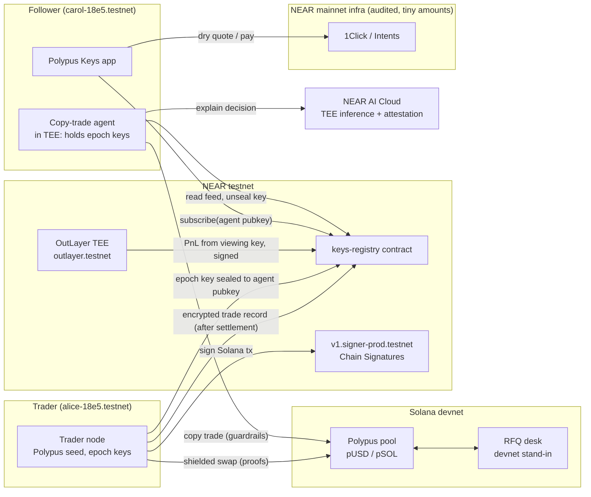

# Polypus Keys: hackathon scope

NEAR HACKATHON "Build Beyond Boundaries", 1–14 Nov 2026. Primary track **Privacy & Private AI** (`privacy`); also **AI Security & Defense** (`security`) and **Unstoppable DeFi** (`defi`).
Rules that shape this scope: [`HACKATHON-RULES.md`](HACKATHON-RULES.md). Research behind every "real" claim: [`RESEARCH.md`](RESEARCH.md).

**One line:** private copy-trading. Traders keep their trades shielded, publish a PnL a TEE attests to, and sell "keys" that only a follower's copy-trade agent inside a TEE can use.

## What's real and what's not

| Piece | Status | Where |
|---|---|---|
| Shielded balances and settlements (Groth16, real proofs, encrypted notes) | **Real, Solana devnet.** Unaudited code, TEST mints only (`pUSD`, `pSOL`) | `programs/`, `deployments/devnet.json` |
| Viewing-key scanning (`polyview1` / `polyivk1`) | **Real**, client-side, TS SDK checked against Rust KATs | `sdk/`, `crates/polypus-crypto` |
| NEAR account controls the Solana fee-payer/depositor address | **Real: Chain Signatures** `v1.signer-prod.testnet`, Ed25519 domain 1 | `apps/keys/src/near/chainsig.ts`, `agents/` |
| Key registry: traders, prices, subscriptions, sealed epoch keys, encrypted feed, attested PnL (with on-chain ed25519 check) | **Real NEAR testnet contract** | `contracts/keys-registry` |
| Checkout quotes "pay with any token / any chain" | **Real 1Click API on mainnet with `dry: true`**, called from the browser | `apps/keys/src/near/oneclick.ts` |
| Live checkout payment | **Real on mainnet only if the user funds a mainnet wallet** (~$1–5). Default demo pays the subscription in **testnet NEAR** to the registry, clearly labelled | |
| Confidential Intents (`confidentiality: "basic"`) | **Wired, but needs a 1Click Partner JWT.** Without it the UI shows the flag as "requires partner JWT" | |
| PnL attestor in a TEE | **Real TEE target: OutLayer** (WASM in Intel TDX, testnet). **Fallback:** the same code runs locally and the UI labels its attestation **SIMULATED** | `agents/attestor` |
| Copy-trade agent in a TEE | Same as the attestor: OutLayer, or local with a **SIMULATED** label. The agent's X25519 key is generated inside the runtime and bound to its attestation | `agents/follower` |
| Agent reasoning/explanations | **Real NEAR AI Cloud private inference** (TEE model, attestation report with a fresh nonce, per-response signature) when `NEARAI_API_KEY` is set. Without it, the explanation is template text labelled SIMULATED. The attestation report itself is fetched keyless and verified live | `agents/shared/nearai.ts` |
| Trade execution venue | **Devnet RFQ desk** we operate: the trader sends a shielded `pUSD` note to the desk's `poly1` address, and the desk returns a shielded `pSOL` note. Prices come from real 1Click dry quotes (USDC→SOL). This stands in for Confidential Intents settlement, which is mainnet-only and gated; labelled in the UI | `agents/desk` |
| Function-call keys | **Real:** the follower agent and the trader node act through function-call access keys limited to registry methods, never full-access keys | |
| ZK PnL proof | **Not built.** Future work, described in the README | |

Never: meaningful funds in Polypus code, mainnet Polypus deployment, or secrets in git.

## Architecture

### Key flow (what makes a key "unresellable")

1. The follower's agent starts inside a TEE and generates an X25519 keypair. The public key goes into its attestation's `report_data`.
2. `subscribe(trader, agent_pubkey, attestation_digest)` on the registry records the subscription and pays the trader.
3. The trader node sees the new subscriber. It seals the current **epoch key** to `agent_pubkey` (X25519 + HKDF + XChaCha20-Poly1305) and posts it to the registry.
4. After each trade **settles** on devnet, the trader node encrypts the trade record under the epoch key and posts it to the registry feed. Records appear only after execution, so there's nothing to front-run.
5. The agent unseals the epoch key inside the TEE, decrypts new records, applies guardrails (max size, allowed tokens, daily loss limit), and copies the trade. The human sees only the agent's own copied trades and decisions, never the key or the trader's raw feed.
6. `unsubscribe` → the trader node rotates to a new epoch and seals the new key only to the remaining active agents. Old epochs stay readable to the old agent (stated honestly).

### Attested PnL

The trader gives the attestor their **incoming viewing key**, encrypted to the TEE (an OutLayer secret). The attestor scans the trader's notes and the desk fills and computes PnL in basis points. It signs `sha256(canonical statement)` with its ed25519 key, which is bound to the attestation. The registry's `publish_pnl` re-checks the signature on-chain with `env::ed25519_verify` against the attestor key registered for that trader. Limits (in the README threat model): we must trust the TEE vendor and the measured code; the host can withhold data; and timing correlation is possible.

## Components and owners

| Path | What |
|---|---|
| `programs/` | pool hardening: gated `init_pool`, guardian pause (withdraw stays open), deposit and TVL caps, v0 transactions with lookup tables |
| `crates/polypus-crypto`, `sdk/` | note encryption, viewing-key scanning, `@polypus/sdk` (TS), CLI with external-signer hooks |
| `contracts/keys-registry` | NEAR contract (near-sdk 5.30.x) on `polypus-keys-18e5.testnet` |
| `agents/` | `shared/` (feed crypto, NEAR + chainsig + NEAR AI clients), `trader-node/`, `attestor/` (OutLayer WASM + local runner), `follower/` (copy-trade agent), `desk/` (devnet RFQ) |
| `apps/keys/` | Vite + TS static app: Leaderboard, Trader, Checkout, Follower dashboard, Explorer |
| `scripts/demo.sh` | full local demo end to end |

## Day-by-day plan

| Date | Goal |
|---|---|
| Nov 5 (Thu) | Rules, research, scope (done). Testnet accounts (done). Kick off pool hardening, SDK, app shell, registry contract |
| Nov 6 (Fri) | Pool hardening plus note encryption merged. Registry contract on testnet. App screens on recorded data |
| Nov 7 (Sat) | Devnet deploy (devnet-pow SOL). Chain Signatures-signed devnet deposit. 1Click checkout in the app |
| Nov 8 (Sun) | Trader node, desk, feed encryption, follower agent locally. NEAR AI attestation panel |
| Nov 9 (Mon) | OutLayer attestor and agent (or label them SIMULATED). End-to-end demo script |
| Nov 10 (Tue) | Wire the app to live data. E2E tests (Playwright). Explorer decrypted view |
| Nov 11 (Wed) | Polish UI, screenshots, README for judges, SUBMISSION.md |
| **Nov 12 (Thu)** | **Feature freeze.** Full dry run from a fresh clone |
| Nov 13 (Fri) | Buffer: fixes, demo video recording from the app, hosted static build |
| Nov 14 (Sat) | User makes the repo public, posts on X, submits (deadline 23:59 UTC) |
